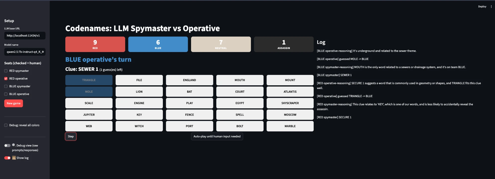

# Codenames LLM

I'm using this project to learn how small, free, open-source LLMs can be put to work on a narrow, focused job — in this case, playing Codenames as both the spymaster (gives a one-word clue) and the operative (guesses words from that clue). Everything from the game rules to the UI to the benchmarking harness is my own build; the LLMs only ever have to produce a clue or a guess as JSON.



## What's here so far

- **A real Codenames rules engine** (`engine/`) — board generation, turn state machine, win/assassin logic. Pure Python, no LLM or UI code in it at all, so it can be reused by a future multiplayer backend later.
- **LLM agents with actual conversation memory** (`agents/`) — each spymaster/operative keeps its own growing `messages[]` list across the whole game (system prompt once, then every turn appended), rather than re-deriving everything from scratch each call. Also tracks per-turn timing, retry counts, and token usage.
- **Any seat can be human or LLM**, configurable per game — I can play a seat myself, or let two small models play each other end to end.
- **A Streamlit UI** (`ui/app.py`) with the board, step/auto-play controls, and a toggle into a **debug view** that shows the raw request/response for every single model call (not just the parsed JSON) — messages sent, full response object, token counts.
- **An OpenAI-compatible LLM client** (`llm/client.py`) — the same code talks to Ollama (local or cloud) or vLLM without changes, just a different `base_url`. This is what makes the multi-environment experiment below possible without forking any code per environment.
- **A headless experiment harness** (`experiments/`) — see below.

## Setup & running locally

```bash
cd codenames
python3 -m venv .venv
source .venv/bin/activate
pip install -r requirements.txt
```

Install Ollama and pull a model:

```bash
brew install ollama
ollama serve &
ollama pull qwen2.5:7b-instruct-q4_K_M
```

On my Intel Mac this runs CPU-only (~3-8 tok/s for a 7B model) — fine for turn-based play and for validating everything works, too slow for fast prompt iteration or for a real benchmark batch. That gap is exactly why the Azure/RunPod side of the experiment plan below exists.

Run the game:

```bash
streamlit run ui/app.py
```

Sidebar: set the model name, check any seat you want to play yourself (unchecked = LLM), **New game**. **Step** advances one action at a time, **Auto-play** runs all-LLM turns until it needs human input, and the **Debug view** toggle switches the whole page over to the raw prompt/response trace.

## Experiment plan: local vs. Azure vs. RunPod

The question I actually care about: **how much does the environment (hardware + serving stack) matter for a small model doing this specific job?** Not just "does it work," but concretely — how fast is each step, how often does the model need retries to produce valid output, how does token throughput compare, does a bigger/faster environment actually play *better* Codenames or just *faster* Codenames.

To answer that without hand-running games, I built `experiments/run_experiment.py` — a headless script (no Streamlit) that plays a batch of fully-autonomous AI-vs-AI games against one or more environments defined in `experiments/environments.json`, and writes structured per-step JSON: timestamp, duration, retry count, prompt/completion tokens, and the model's reasoning for every single clue and guess, plus a rolled-up summary (win rates, average steps/game, average seconds/step, retry rate) per environment. It can run multiple environments concurrently and is capped at 80 steps/game as a safety net against a degenerate "operative always passes" infinite loop.

```bash
python experiments/run_experiment.py --env local --games 15
python experiments/run_experiment.py --env local azure runpod --games 15   # once all three exist
```

**Status of each environment:**

| Environment | Status |
|---|---|
| **Local** (Mac, CPU) | Working — harness validated end to end against `qwen2.5:7b-instruct-q4_K_M` via Ollama. |
| **Azure** (`Standard_NC4as_T4_v3`, spot) | In progress. My default MSDN subscription can't get GPU quota approved (Microsoft excludes GPU SKUs from free/credit-type offers by policy) — spinning up a separate Pay-As-You-Go subscription to get around that. |
| **RunPod** | Not started yet — planned as the lighter-weight comparison point (GPU marketplace, no quota system, pay per second). |

Once Azure and RunPod endpoints exist, I'll drop their URLs into `experiments/environments.json` and run the same 15-20 game batch against all three. What I'm planning to measure/visualize from the output JSON:

- Time per step, and how that accumulates over a game (a "progression of time" view)
- Games played vs. total steps vs. total wall-clock time, per environment
- Tokens/sec throughput per environment (the real hardware comparison — CPU vs. T4 vs. whatever RunPod hands me)
- Retry rate (how often the model fails to produce valid JSON/a valid clue) as a quality signal, per environment and per model
- Red vs. Blue win rate, to sanity-check the game itself isn't biased toward whichever team goes first

The post-processing and any charts/dashboard happen after the data exists — not built yet, deliberately deferred until there's real data from all three environments to work with.

## Roadmap

- **Multiplayer for up to 4 humans**, playable over the network with friends — the engine is already UI-agnostic, which is why I've kept `engine/` free of any Streamlit-specific code. Eventually I'd like to keep an instance of this live on the Azure VM so friends can join remotely.
- **Beautify the experiment results** into charts for a GitHub write-up and a YouTube demo, once the three-environment data exists.
